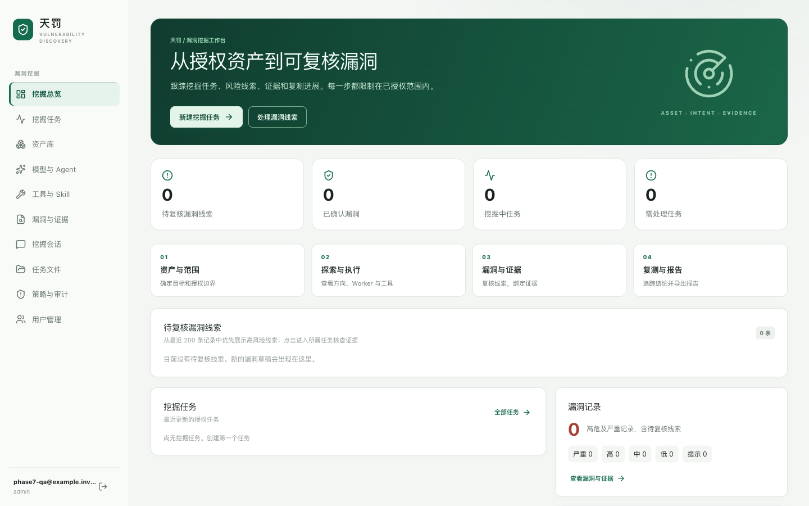
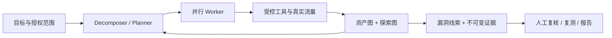

# 天罚 · TianFa

### 以授权为界，以证据为刃。

**天罚是一套面向授权安全团队的自主漏洞挖掘平台。** 你给出目标与范围；Decomposer 拆解目标，Planner 决定方向，多个 Worker 并行调用真实工具。资产、探索、流量、漏洞线索和证据被写进同一条可追溯、可恢复的链路。

> **每一次出手，都有边界。每一条发现，都有来路。**

**Go · Next.js · PostgreSQL · Docker**　|　**Phase 0–6 核心能力已交付，Phase 7 加固与最终验收进行中**



[当前完成情况与缺口](docs/project-status.md) · [核心规格](全新自主安全验证平台-核心能力实现规格.md) · [运维手册](docs/operations.md) · [窄屏预览](docs/qa/phase7-mining-dashboard-mobile.png)

## 从目标到证据，整条链路都看得见



| 能力 | 天罚怎么做 |
| --- | --- |
| **自主推进** | Planner 根据目标与图事件分派 Intent；Worker 一次聚焦一个方向，支持并行、Todo 依赖、人工纠偏与持久恢复。 |
| **双图血缘** | 资产图保存客观资产，探索图记录 Goal、Intent、Fact、Finding；从发现可以回看 Run 和 ToolCall。 |
| **工具边界** | Scope 在工具边界执行，DNS、重定向和连接地址均接受校验；审批、角色与 Schema 约束模型动作。 |
| **模型主备** | Profile 链按顺序故障转移，独立记录尝试、Token 与错误；单个 Key 配额耗尽不必终止整条任务。 |
| **证据优先** | 真实 HTTP 流量进入内容寻址 Blob；Finding 绑定不可变快照，删普通流量后证据仍可读取和校验。 |
| **可解释的工作台** | 任务状态、Worker 独立额度、工具执行、策略阻断、实时动态、证据版本和报告状态都能在界面查看。 |

天罚把“发现了什么”与“为什么相信它”放在一起。一个待复核线索可以追到目标、资产、探索方向、Agent Run、工具调用和原始 HTTP 证据；只有经过人工复核，才进入已确认漏洞。Worker 的模型回合、工具次数、Token 和时长额度由 Planner 按方向分配，服务端逐次执行限制，用户无需配置预算。

## 快速启动

需要 Docker Desktop。仓库根目录执行：

```bash
docker compose up --build
```

打开 <http://localhost:8080>，然后在交互终端初始化唯一管理员：

```bash
docker compose exec app tianfa-server init-admin
```

设置邮箱和至少 12 字节的密码后，到 `/login/` 登录。管理员先在 `/models/` 创建模型 Profile、填写 API Key 并设置默认主备链；随后在 `/tasks/` 创建任务，填写可验证目标与至少一条 Allow 授权范围，再启动挖掘。没有可用模型链时，任务不会伪装成已启动。

健康检查：

```bash
curl http://localhost:8080/health/live
curl http://localhost:8080/health/ready
```

端口 `8080` 被占用时：

```bash
TIANFA_HOST_PORT=18080 docker compose up --build
```

此时访问 <http://localhost:18080>。生产部署应使用 HTTPS 反向代理；纯 HTTP 登录只允许本机回环地址。

## 在工作台里做什么

1. **圈定战场**：创建挖掘任务，设定 Goal、Scope、策略模式、Worker 并发和模型路由；从资产页关联已有资产。
2. **观察推进**：查看 Planner 的方向、Todo 依赖、Worker Run、独立额度、ToolCall、策略判定、实时 Activity 与双图覆盖；可以暂停、恢复、取消、纠偏或重试方向。
3. **复核线索**：在 `/findings/` 查看流量与待复核 Finding，绑定 baseline、proof 或 verification 证据；确认漏洞、记录人工复测、导出 Markdown、JSON 或证据 ZIP 报告。
4. **治理工具**：在 `/tools/` 管理内置工具、Skill、MCP、自定义只读 HTTP 工具与审批；在系统页查看策略阻断和追加式审计。

记录代理默认在本机 `127.0.0.1:8081`，使用页面生成的一小时任务令牌进行代理认证：用户名 `tianfa`，密码为令牌。受控客户端可下载本地 CA 捕获 HTTPS。当前代理仅支持范围内、无正文的 GET/HEAD；配置步骤见 [Phase 5 验收记录](docs/phase5-plan.md)。

## 安全边界与数据恢复

- **范围由程序强制。** `http.read` 和记录代理在连接前校验目标；私网、回环、链路本地等地址默认受保护。远端 MCP 服务自身发起的次级请求不受本进程控制，接入前须约束其网络出口。
- **Secret 与证据分开保护。** API Key 加密保存，主密钥位于数据目录 `secrets/master.key`；丢失密钥时服务拒绝把已有加密凭据当作可用。Blob 读取和报告导出会校验哈希。
- **备份必须成套。** `make backup` 创建 PostgreSQL、Blob、工作区、Skill 与密钥材料的 Compose 冷备份；`make restore-drill BACKUP_DIR=/path/to/backup` 在隔离环境中演练恢复和完整性检查。备份目录含敏感材料，按密钥级别保护。详见 [运维手册](docs/operations.md)。
- **隔离命令默认关闭。** 配置 `TIANFA_TOOL_IMAGE` 后才开放容器命令工具；MCP stdio 使用无网络容器。详细边界见 [Phase 4 验收记录](docs/phase4-plan.md)。

## 开发与验证

本地分别运行后端与前端：

```bash
make dev-server
make dev-web
```

后端默认监听 `:8080`，前端开发服务器监听 `:3000`。后端使用其他地址时设置 `TIANFA_DEV_API_ORIGIN`，例如 `TIANFA_DEV_API_ORIGIN=http://127.0.0.1:18080 make dev-web`。源码开发可用 `go run ./cmd/server init-admin` 初始化管理员。

```bash
make test     # OpenAPI、备份归档、Go 测试和前端类型检查
make build    # 前端静态导出并嵌入 Go 服务
make vet
make race
```

PostgreSQL 集成测试需要 `TIANFA_TEST_DATABASE_URL`，CI 会配置独立测试数据库。`make perf-core` 另需 `TIANFA_PERF_DATABASE_URL`；正式性能结论必须在规格规定的参考环境得出。OpenAPI 由 Go 契约生成，运行 `make openapi` 更新、`make openapi-check` 检查漂移。

## 当前进度

核心挖掘链路和工作台已交付，**最终发布验收尚未完成**。Phase 7 仍需六个完整端到端场景、剩余故障注入、参考环境性能与 1 GB 流量清理测试、全面安全和可访问性审计，以及签名镜像工作流实跑。自动 Retester Agent、非 HTTP 证据类型等功能缺口也已明确列入进度报告。

逐项证据与下一步见 **[已完成能力与剩余工作](docs/project-status.md)**；阶段拆分见 [实施计划](docs/implementation-plan.md) 与 [Phase 7 验收计划](docs/phase7-plan.md)。
