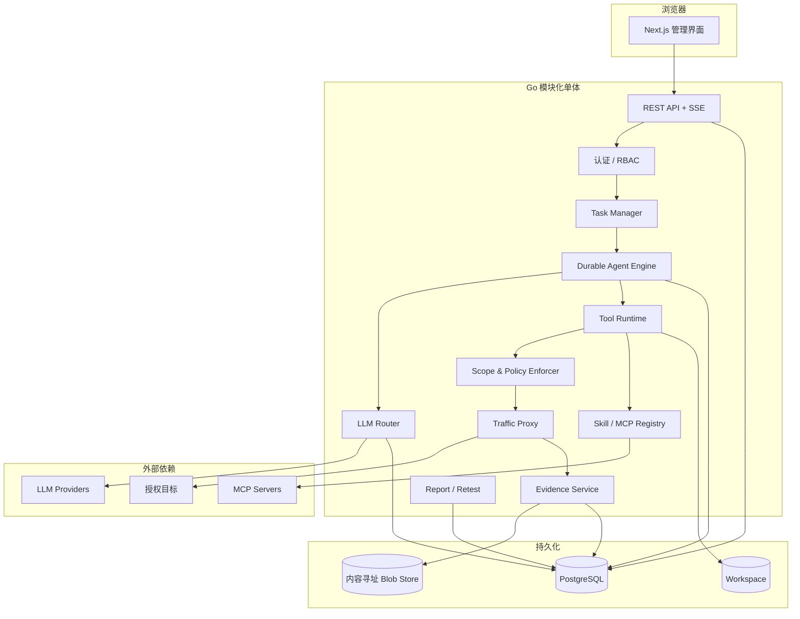
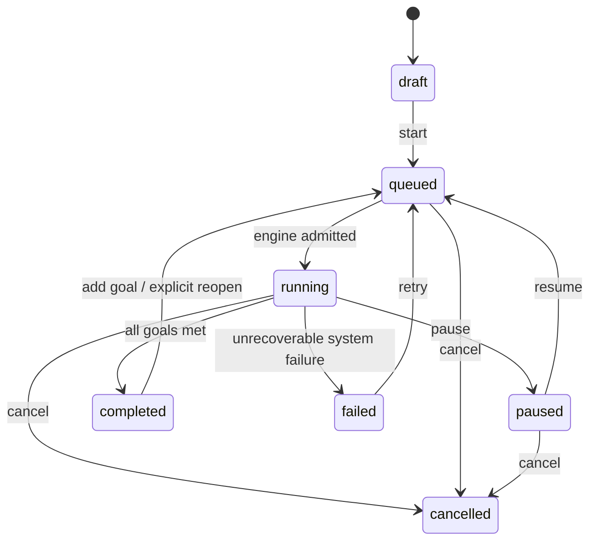
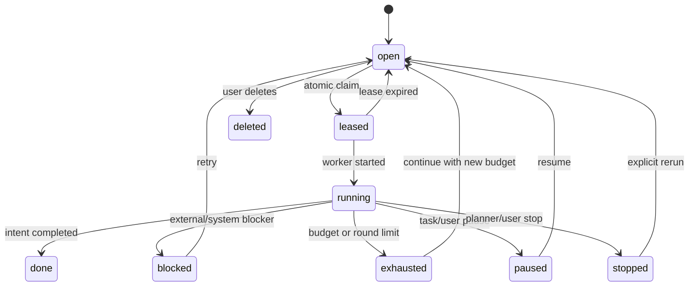
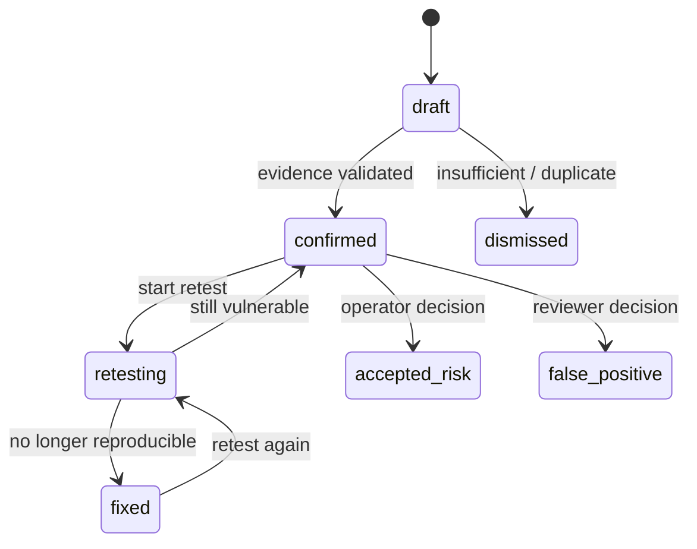
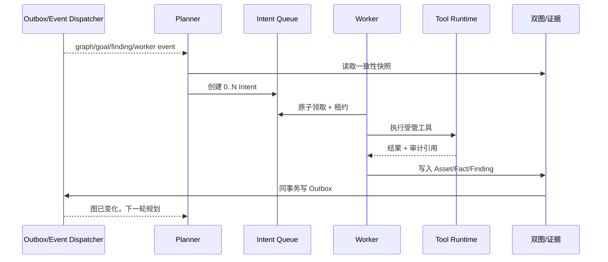
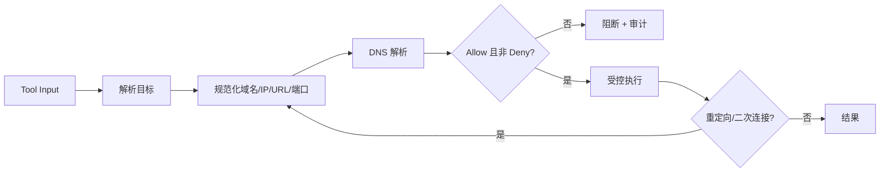

# 全新自主安全验证平台：核心能力实现规格

> 文档类型：可直接交给 AI 编程代理的实现蓝图  
> 项目名称：未命名；实现前可独立命名，但不得借用既有项目身份  
> 目标版本：净室设计 v1.0；不存在历史版本、兼容层或迁移包袱  
> 技术基线：Go + Next.js + PostgreSQL + Docker Compose  
> 部署形态：单组织私有部署、多用户协作  
> 安全边界：仅用于获得明确授权的安全测试；默认在已声明范围内自主执行，范围外强制阻断

---

## 0. 如何使用本文档

本文档不是产品介绍，而是一套全新系统的规范性契约。未来的实现者应把本文档与测试一起视为系统的唯一产品事实来源。

- **MUST / 必须**：缺失即不算完成。
- **MUST NOT / 禁止**：实现不得出现的行为。
- **SHOULD / 应当**：默认实现；偏离时必须记录理由和等价保障。
- **MAY / 可以**：不破坏核心契约的可选能力。

需求使用 `REQ-<领域>-<编号>` 标识。测试、API、数据库迁移和 UI 功能应引用对应需求号。若正文与示例冲突，以带需求号的文字为准。

本文档刻意不包含任何真实 API Key、密码、目标地址或本机秘密路径。凭据只允许通过 Secret 引用进入运行时。

### 0.1 净室实现约束

这是一个从零开始的新产品，不是任何已有产品的复刻、重写、分支或兼容版。即使 AI 认为本文中的某些概念与其训练记忆中的项目相似，也必须忽略这种联想。

- `REQ-CLEAN-001`：AI 必须只依据本文档和用户随后明确提供的新需求设计产品，不得凭记忆补全任何既有项目的代码、提示词、数据库、API、页面或缺省值。
- `REQ-CLEAN-002`：禁止搜索、克隆、读取、引用或逆向任何被认为“相似”的既有仓库、发行包、截图、文档或线上 Demo，除非用户日后明确把某份材料指定为新需求的参考输入。
- `REQ-CLEAN-003`：禁止为了兼容未知历史行为而添加别名路由、旧表迁移、旧配置解析、遗留状态或适配层。
- `REQ-CLEAN-004`：程序包名、二进制名、服务名、数据库名、环境变量前缀、默认端口、UI 视觉、文案与提示词都必须在 Phase 0 重新定义，不得从模型记忆中沿用。
- `REQ-CLEAN-005`：本文描述的是能力和不变量。实现者必须从第一性原理形成自己的模块边界与代码，不得追求与任何未知实现的文件级或符号级相似。
- `REQ-CLEAN-006`：如果本文没有定义某项行为，AI 必须把它列为显式设计决策并说明权衡，不能声称“按照原项目处理”。

### 0.2 临时技术标识

在用户确定正式品牌前，文档示例统一使用中性标识：

- Go module：`example.invalid/security-platform`。
- 二进制：`security-platform-server`。
- Compose 服务：`app`、`postgres`。
- 环境变量前缀：`SECPLAT_`。
- API Problem Type 域名：`https://spec.example.invalid/problems/`。

这些只是新工程的占位符，不是产品名称。Phase 0 可以一次性替换；替换后必须通过配置、OpenAPI、部署文件和文档的一致性检查。

---

## 1. 产品定义与完成标准

本平台面向获得明确授权的安全团队，是一个自主执行安全验证任务的多 Agent 系统。它不是“把聊天模型接到终端”的薄壳；它必须将目标、资产、探索过程、真实工具调用、流量、证据、漏洞和复测结果组织为可恢复、可追溯的数据闭环。

### 1.1 一句话定义

> 用户给出目标和授权范围，系统将目标拆成可验证的探索方向，由多个 Worker 并行使用真实工具执行，把新资产、事实、漏洞证据写回双图；Planner 根据图的变化持续规划，直到目标被证明、任务被停止或预算耗尽。

### 1.2 核心成功标准

- `REQ-PROD-001`：用户必须能创建包含目标、范围、约束、预算和模型路由的任务，并能启动、暂停、恢复、取消。
- `REQ-PROD-002`：系统必须使用“资产图 + 探索图”分别表达客观资产真值和一次任务的推理/验证血缘，并用锚点连接两图。
- `REQ-PROD-003`：Planner 必须由图事件驱动；Worker 必须一次只负责一条 Intent；多个 Worker 可以并行，但不得自行扩大任务方向。
- `REQ-PROD-004`：每一次真实工具调用都必须留下输入、输出摘要、完整输出位置、时间、Agent、任务、Intent、策略判定和错误信息。
- `REQ-PROD-005`：漏洞必须能关联一份或多份不可变证据；删除普通流量不得破坏已经绑定的漏洞证据。
- `REQ-PROD-006`：服务重启后，任务、图、队列、会话、模型路由和证据必须可恢复，不得依赖仅存在于内存中的关键状态。
- `REQ-PROD-007`：同一模型的两个 Key 或多个模型 Profile 必须支持按顺序自动故障转移；配额耗尽后任务应继续，而不是整条任务失败。
- `REQ-PROD-008`：Scope Enforcer 必须在工具边界执行。提示词中的“不要越界”不能替代程序校验。
- `REQ-PROD-009`：UI 必须能解释“系统正在做什么、为什么做、得到了什么证据、下一步是什么”，而不仅展示最终聊天文本。
- `REQ-PROD-010`：所有核心能力必须有自动化测试和端到端验收场景，满足第 17 章才可宣布完成。

### 1.3 本版明确不做

以下内容不属于核心闭环，首版不实现：在线自更新、IM/邮件漏洞推送、第三方资产平台同步、多租户计费、插件市场、移动端客户端。它们以后只能通过稳定 API 或事件订阅扩展，不得侵入核心调度器。

---

## 2. 设计原则与系统不变量

### 2.1 数据优先于对话

- `REQ-ARCH-001`：对话记录是运行过程，不是业务真值。目标、范围、资产、Intent、Fact、Finding、Evidence 和状态必须存入结构化存储。
- `REQ-ARCH-002`：模型输出不得直接改数据库；它只能调用受 Schema 校验、权限校验、范围校验和事务保护的工具。
- `REQ-ARCH-003`：模型声称“已完成”不等于完成。目标只能通过 `prove_goal` 或等价的受管操作变更为已达成，且必须引用事实或漏洞节点。

### 2.2 Planner 与 Worker 分权

- `REQ-ARCH-004`：Planner 是自主流程中唯一可以创建普通 Intent 的角色；Main Agent 可以代表人工创建高优先级 Intent。
- `REQ-ARCH-005`：Worker 只能完成被领取的单条 Intent。它可以产生 Asset、Fact、Hint、Finding，但不能创建新的自主探索方向。
- `REQ-ARCH-006`：Worker 发现旁支时必须写成 Fact 或 Hint 交回 Planner，不得自行跨 Intent 执行。

### 2.3 证据优先

- `REQ-ARCH-007`：Fact 必须区分“观察”“推断”“否定结果”，并带来源、置信度和产生它的 Intent。
- `REQ-ARCH-008`：Finding 必须包含可复核的影响、目标、复现步骤和至少一种证据。没有 HTTP 流量时允许使用命令输出、截图、文件哈希或日志，但必须说明原因。
- `REQ-ARCH-009`：报告是 Finding 与 Evidence 的派生视图，不得成为唯一保存漏洞事实的地方。

### 2.4 可恢复与幂等

- `REQ-ARCH-010`：所有异步 Job 必须使用持久化状态、租约和幂等键；进程崩溃后租约到期可重新领取。
- `REQ-ARCH-011`：工具执行结果、模型回合和事件写入必须带稳定关联 ID，重试不能造成重复资产、重复漏洞或重复工具副作用。
- `REQ-ARCH-012`：任何“先写文件、后写数据库”的流程必须支持孤儿文件回收；任何“先写数据库、后写文件”的流程必须保证记录在文件缺失时不可见或可恢复。

---

## 3. 总体架构

### 3.1 组件分层



### 3.2 进程与部署

- `REQ-DEPLOY-001`：后端使用 Go 构建单一 `security-platform-server` 可执行文件；生产构建应将 Next.js 静态导出文件通过 `go:embed` 内嵌。正式命名后统一替换占位名。
- `REQ-DEPLOY-002`：HTTP 与流量代理地址必须通过 `SECPLAT_HTTP_ADDR`、`SECPLAT_PROXY_ADDR` 配置；开发默认值分别为 `:8080`、`127.0.0.1:8081`。流量代理不得默认暴露到公网。
- `REQ-DEPLOY-003`：Docker Compose 至少包含 `app` 与 `postgres` 两个服务，并挂载 `data/`、`skills/` 和 PostgreSQL 数据卷。
- `REQ-DEPLOY-004`：数据库迁移必须内嵌进二进制并在启动时通过 PostgreSQL advisory lock 串行执行。
- `REQ-DEPLOY-005`：必须提供 `/health/live` 和 `/health/ready`。Ready 只有在数据库可用、迁移完成、Blob/Workspace 可写时返回成功；没有可用 LLM 时服务仍可 Ready，但任务启动必须给出明确错误。
- `REQ-DEPLOY-006`：优雅退出时停止领取新 Intent，给运行中工具有限的收场时间，持久化检查点后退出；不得把正常关机标记为任务失败。

### 3.3 推荐技术版本

实现时使用当时仍受支持的稳定版本，不固定补丁号，但必须满足：

- Go：当前稳定版，使用 `net/http`、`context`、`pgx`。
- PostgreSQL：16 或更高。
- Next.js：支持静态导出，React + TypeScript。
- 前端状态：服务端数据使用 TanStack Query 或等价方案；仅界面偏好使用轻量本地 Store。
- Schema：API 与工具输入统一使用 JSON Schema；前端运行时校验使用 Zod 或等价方案。

---

## 4. 核心领域模型

### 4.1 标识、时间和删除约定

- 所有外部可见主键使用 UUIDv7 字符串；数据库内部可以另有 BIGINT 顺序键，但 API 不得暴露它作为永久身份。
- 所有时间以 PostgreSQL `TIMESTAMPTZ` 保存，API 使用 UTC RFC 3339。
- 核心审计数据只允许软删除；Blob 采用引用计数和延迟回收。
- JSON 扩展字段必须带 `schema_version`，禁止无版本地长期堆放任意 JSON。

### 4.2 任务聚合

| 实体 | 必要字段 | 关键不变量 |
| --- | --- | --- |
| `organizations` | `id,name` | 首版只有一个组织，但所有用户和任务仍带组织 ID |
| `users` | `id,organization_id,email,password_hash,role,status` | 角色为 `admin/operator/reviewer/viewer` |
| `tasks` | `id,title,description,status,policy_mode,worker_limit,deadline,budget,version` | 状态变更使用乐观锁 `version` |
| `task_goals` | `id,task_id,text,state,priority` | `met` 必须关联证明边 |
| `task_constraints` | `id,task_id,effect,text,source` | `deny` 优先于 `allow` |
| `task_scopes` | `id,task_id,kind,value,ports,path_prefix,effect` | 标准化后唯一；变更产生新版本 |
| `task_todos` | `id,task_id,title,status,depends_on,source_round` | 由 Planner 跨回合共享 |
| `task_budgets` | Token、费用、时长、工具调用数 | 每次消耗必须原子累计 |

### 4.3 资产图

资产图是组织级共享真值库，不因任务结束而删除。


`assets` 至少包含：

```text
id, organization_id, kind, canonical_key, display_value,
parent_id, attributes_json, first_seen_at, last_seen_at,
source_task_id, confidence, created_at, updated_at
```

- `REQ-ASSET-001`：`kind` 至少支持 `company/root_domain/subdomain/ip/service/application/endpoint`。
- `REQ-ASSET-002`：服务端必须按类型计算 `canonical_key`，模型不得自行决定去重键。
- `REQ-ASSET-003`：同组织、同类型、同 canonical key 只能有一条资产；重复写入应合并可合并属性并更新 `last_seen_at`。
- `REQ-ASSET-004`：写入域名、IP、URL 和端口时必须进行语法标准化，但必须保留原始值与来源。
- `REQ-ASSET-005`：任务通过 `task_asset_links` 引用全局资产；删除任务不得删除仍被其他任务引用的资产。

### 4.4 探索图

探索图每个任务一份，表达“为什么开展这个方向、做了什么、得到了什么”。

节点类型：

| 类型 | 说明 | 典型状态 |
| --- | --- | --- |
| `origin` | 任务创建时的根事实 | `confirmed` |
| `goal` | 用户要达成的结果 | `open/met/abandoned` |
| `intent` | 可由一个 Worker 独立执行的探索方向 | 见第 5 章 |
| `fact` | 可复用的观察、结论或否定结果 | `confirmed/dismissed` |
| `finding` | 已登记的安全问题在图中的投影 | `confirmed/dismissed` |
| `hint` | 尚未验证但值得规划的线索 | `active/consumed` |
| `digest` | 冷节点的可逆摘要 | `active/superseded` |

边类型：

- `spawns`：目标/事实/提示产生 Intent。
- `derived_from`：节点来源于另一节点。
- `yields`：Intent 产出 Fact、Hint 或 Finding。
- `proves`：Fact/Finding 证明 Goal。
- `covers`：Digest 覆盖但不删除原节点。

- `REQ-GRAPH-001`：任何 Intent 必须能沿反向边追溯到 Origin 或 Goal。
- `REQ-GRAPH-002`：任何 Worker 产生的 Fact/Finding 必须通过 `yields` 连接到当前 Intent。
- `REQ-GRAPH-003`：`exploration_anchors(node_id, asset_id)` 必须允许任意探索节点锚定多个资产。
- `REQ-GRAPH-004`：图写入必须在一个数据库事务内完成节点、边、锚点、事件和预算更新。
- `REQ-GRAPH-005`：图压缩只能改变提供给模型的视图，不能删除原始节点、边或 Activity。

### 4.5 运行、活动与审计

| 实体 | 用途 |
| --- | --- |
| `agent_runs` | 一次 Planner/Worker/Main/Reporter/Retester 运行及终态 |
| `agent_messages` | 规范化的模型消息与工具调用关系 |
| `activities` | 面向 UI 的追加式时间线 |
| `tool_calls` | 工具输入、策略判定、执行状态、输出引用和耗时 |
| `worker_leases` | Intent 的领取者、心跳、到期时间和 attempt |
| `domain_events` | 事务内 Outbox；驱动 Planner、SSE 和后台任务 |
| `audit_log` | 用户与系统的安全审计，不允许 UPDATE/DELETE |

- `REQ-DATA-001`：业务事务与待发布事件必须通过 Transactional Outbox 同时提交。
- `REQ-DATA-002`：事件消费者用 `(consumer_name,event_id)` 去重，保证至少一次投递下的幂等效果。
- `REQ-DATA-003`：Activity 是可重建视图；关键状态不得只存在 Activity 文本中。

---

## 5. 状态机

### 5.1 Task 状态



- `REQ-STATE-001`：Task 状态只能通过受管命令转换，禁止任意 PATCH 状态字符串。
- `REQ-STATE-002`：`completed` 只在所有非 abandoned Goal 为 `met` 且没有 active Intent 时产生。
- `REQ-STATE-003`：没有可用 LLM、模型短暂故障或单个 Worker 失败不得直接把 Task 标记为 `failed`。
- `REQ-STATE-004`：暂停后不得领取新 Intent；运行中工具应在安全检查点暂停或结束后将 Intent 置为 `paused`。

### 5.2 Intent 状态



- `REQ-STATE-005`：领取使用单条原子 SQL（如 `FOR UPDATE SKIP LOCKED`），并写入有限租约。
- `REQ-STATE-006`：Worker 每隔不超过租约三分之一时间续租；进程失联后租约到期回到 `open`。
- `REQ-STATE-007`：`blocked` 表示外部条件或系统错误导致基本未完成；`exhausted` 表示做了部分工作但预算耗尽；`stopped` 表示被控制面终止。
- `REQ-STATE-008`：重跑必须增加 attempt，保留之前所有 Run 与 Activity，使用新 Run ID。
- `REQ-STATE-009`：Intent 达到最大 attempt 后不得无限重排，应转 `blocked` 并生成可操作的原因。

### 5.3 Finding 状态



每次状态变化必须记录操作者、原因、证据版本和时间。模型可以提出变化，但 `false_positive` 与 `accepted_risk` 只能由 Reviewer 或 Admin 确认。

### 5.4 ToolCall 与 LLM Profile 状态

- ToolCall：`queued -> policy_check -> running -> succeeded|failed|blocked|cancelled`。
- LLM Profile：`healthy -> degraded -> open_circuit -> half_open -> healthy`，管理员可以置为 `disabled`。
- ToolCall 一旦进入 `running`，同一 `idempotency_key` 的重复请求只能返回已有执行结果或明确的 `in_progress`，不得重复产生副作用。

---

## 6. Agent 角色与提示词契约

### 6.1 角色

| Agent | 输入 | 允许写入 | 禁止行为 |
| --- | --- | --- | --- |
| Goal Decomposer | 用户任务、范围、约束 | Goal、Constraint、初始锚点 | 执行真实测试 |
| Planner | 图快照、覆盖度、Todo、触发事件 | Intent、Todo、Goal 证明、停止/纠偏请求 | 直接运行目标工具 |
| Worker | 一条 Intent、锚定资产、相关事实、约束 | Asset、Fact、Hint、Finding、Activity | 创建普通 Intent、私自扩大范围 |
| Main Agent | 人工消息、当前任务态势 | Goal、Constraint、Hint、高优先级 Intent、Worker 纠偏 | 绕过 Scope/Policy |
| Reporter | Finding、证据、血缘 | 结构化漏洞报告 | 发起新的探索方向 |
| Retester | Finding、固定证据、复测请求 | Retest Run、复测证据、建议状态 | 静默改为误报/接受风险 |

### 6.2 提示词分层

- `REQ-AGENT-001`：提示词由“可编辑角色正文 + 代码拥有的不变量尾部 + 本轮动态上下文”组成。
- `REQ-AGENT-002`：用户可编辑角色正文，但不能删除范围限制、角色边界、工具写回规则和证据要求。
- `REQ-AGENT-003`：动态任务内容必须放在用户消息或结构化 Context 中，不得拼接进长期系统提示导致缓存污染。
- `REQ-AGENT-004`：所有提示模板必须版本化；每个 Agent Run 记录实际使用的模板版本和内容哈希。
- `REQ-AGENT-005`：实现必须防御 Prompt Injection：来自目标响应、网页、文件和工具输出的内容都标记为“不可信观察”，不能覆盖系统策略。

### 6.3 Goal Decomposer

流程：

1. 解析任务描述，提取 1..N 个可验证 Goal。
2. 提取显式授权范围和操作约束；无法确定的范围不得猜测。
3. 将任务文本保存为 Origin Fact。
4. 输出结构化工具调用写库，而不是只返回自然语言。
5. 如果范围为空或目标不可验证，任务保留 `draft` 并要求用户补充。

### 6.4 Planner

Planner 每次唤醒是新模型回合，但共享数据库中的 Todo、图与触发事件。

Planner 输入快照至少包含：

```text
task + open goals + constraints + scope version
asset counts + relevant anchored assets + coverage gaps
open/running/recent terminal intents
recent facts/findings/hints + active digests
shared todos and dependencies
trigger events since last planner cursor
remaining task budget and worker slots
```

Planner 算法必须满足：

- `REQ-PLAN-001`：同一任务的 Planner 同时最多一个，通过数据库锁或租约实现。
- `REQ-PLAN-002`：图、Goal、Finding、Worker 终态、人工 Hint、定时心跳均可产生唤醒事件；事件允许 300~1000ms 去抖并合并。
- `REQ-PLAN-003`：Planner 创建 Intent 前必须比较 open、running 和近期 terminal Intent，避免只改措辞的重复方向。
- `REQ-PLAN-004`：串行攻击链必须写入共享 Todo；只派发依赖已经满足的下一步，不能一次性并行派出依赖尚不存在的下游。
- `REQ-PLAN-005`：互不依赖的方向可以并行，但不得超过 Task worker limit 和剩余预算。
- `REQ-PLAN-006`：只要存在未达成 Goal 且没有 open/running Intent，Planner 必须创建至少一条推进方向，或用结构化 `planning_blocked` 解释无法推进的外部条件。
- `REQ-PLAN-007`：Goal 真正达成时，Planner 调用 `prove_goal(goal_id,evidence_node_ids)`；至少一个节点必须能追溯到真实 Worker 结果。
- `REQ-PLAN-008`：Planner 可以停止明显重复或已失去意义的 Worker，但必须记录原因；优先使用 steer 纠偏而不是无条件 kill。

### 6.5 Worker

Worker 启动时获得稳定会话键 `task/<task-id>/intent/<intent-id>/attempt/<n>`，以及独立工作目录。

- `REQ-WORK-001`：Worker 的唯一职责是当前 Intent；启动消息必须明确 Intent、锚定资产和成功判据。
- `REQ-WORK-002`：Worker 必须优先使用真实工具验证；不得把模型知识当成目标事实写入 Fact。
- `REQ-WORK-003`：每个工具调用前经过 Schema、RBAC、Scope 和 Policy 校验；结果经过统一捕获、截断和 Blob 溢写。
- `REQ-WORK-004`：Worker 完成前至少写入一个 Fact、Finding 或结构化否定结果；禁止只有“完成了”文本而没有图写回。
- `REQ-WORK-005`：Worker 可通过 `search_worker_traces` 搜索同任务其他已持久化步骤，并通过 `get_worker_trace` 读取命中详情；默认排除自己的当前 Run。
- `REQ-WORK-006`：人工 steer 消息在下一次模型动作前注入，保留已有上下文和工具结果。
- `REQ-WORK-007`：达到回合、Token、时长或工具预算时进入 settlement 回合，写回阶段性结论后标记 `exhausted`。

终态映射：

| 原因 | Intent 状态 | 是否自动重试 |
| --- | --- | --- |
| 正常完成 | `done` | 否 |
| Provider 短暂故障且未产生副作用 | 保持运行并切 Profile | 是 |
| 所有 Profile 不可用 | `blocked` | 冷却后由调度器重排 |
| 预算/最大回合 | `exhausted` | 否，需 Planner 或用户决定 |
| 用户暂停 | `paused` | 恢复任务时重排 |
| Planner/User 停止 | `stopped` | 否 |
| Scope 阻断 | 当前调用 `blocked`，Worker 可换方法 | 多次无路可走时 Intent `blocked` |

### 6.6 上下文压缩

- 压缩阈值由模型 Context Window 决定，必须预留最大输出、工具 Schema 和安全缓冲。
- 摘要必须保留 Intent、范围、关键事实、未完成 Todo、证据引用、工具副作用和错误。
- 原消息永远保存在数据库或 Blob Store；压缩只是模型视图。
- Skill 指令和代码拥有的不变量在压缩后必须重新注入。

---

## 7. Durable Agent Engine

### 7.1 闭环



### 7.2 调度器

- `REQ-ENG-001`：每个 Task 有独立并发上限；系统另有全局 Worker 上限，防止单任务占满资源。
- `REQ-ENG-002`：队列以优先级、创建时间排序；同优先级保持 FIFO。
- `REQ-ENG-003`：领取 Intent、创建 Agent Run、写租约必须在同一事务中。
- `REQ-ENG-004`：调度器必须公平轮转不同任务；持续产生高优先级 Intent 的任务不能饿死其他任务。
- `REQ-ENG-005`：所有循环使用 `context.Context` 传播停止原因，并区分 pause、cancel、shutdown、deadline、planner_stop。
- `REQ-ENG-006`：服务启动时执行 reconciliation：回收过期租约、恢复 queued/running Task、补发未消费 Outbox、核对孤立 Run。

### 7.3 事务与一致性边界

以下操作必须原子：

1. 创建 Intent + 图边 + 锚点 + Outbox。
2. 领取 Intent + Run + Lease。
3. 写 Fact/Finding + 图血缘 + Activity + Outbox。
4. 证明 Goal + 更新 Task 完成判定 + Outbox。
5. 绑定 Evidence + 增加 evidence version + 标记报告过期。
6. 累计 Token/费用 + 记录 LLM 调用终态。

网络请求、模型调用、命令执行不得在数据库事务中进行。使用“短事务领取 → 外部执行 → 短事务提交结果”的模式。

### 7.4 冷图摘要

当图变大时，Planner 快照不能无限增长。

- 连续若干 Planner Round 无活跃下游的 terminal Intent/Fact 可进入冷区。
- 摘要节点通过 `covers` 指向成员，成员仍可按 ID 查询和恢复。
- 新事件引用冷节点时，该分支重新升温并进入 Planner 快照。
- 摘要合并必须以成员内容版本为输入；成员变化会使旧摘要失效。

---

## 8. Scope 与执行策略

### 8.1 Scope 数据模型

Scope 支持：

```text
domain: example.com 或 *.example.com
ip: 203.0.113.10
cidr: 203.0.113.0/24
url_prefix: https://app.example.com/admin/
service: host + port/protocol
deny: 对以上任意范围的排除项
```

每份 Scope 有不可变版本。Run 和 ToolCall 必须记录使用的 scope version。

### 8.2 强制校验链



- `REQ-SCOPE-001`：所有网络工具，包括 Bash 中的 curl/nmap、浏览器、MCP 和自定义工具，都必须通过统一策略层或受控网络代理；不能只校验显式 HTTP 工具。
- `REQ-SCOPE-002`：DNS 在实际连接前解析并校验所有地址；连接建立后记录实际远端 IP。DNS rebinding、CNAME 链和 IPv4-mapped IPv6 必须覆盖。
- `REQ-SCOPE-003`：每次 HTTP 重定向、代理 CONNECT、WebSocket 升级和浏览器新请求都必须重新校验目标。
- `REQ-SCOPE-004`：Deny 规则优先；未命中明确 Allow 即拒绝。解析失败不得按“可能在范围内”放行。
- `REQ-SCOPE-005`：本平台控制面地址、数据库、宿主机元数据地址、容器管理 Socket 和本机 Secret 路径默认永久禁止作为目标，即使用户 Scope 过宽。
- `REQ-SCOPE-006`：Scope 更新只影响新 ToolCall；正在执行的长任务在心跳点重新检查最新版本，若被收窄则停止。

### 8.3 Policy Mode

系统保留三种模式：

| 模式 | 行为 |
| --- | --- |
| `autonomous` | 默认。范围内自动执行；范围外或平台永久禁区直接拒绝 |
| `graded` | 低风险自动，高风险进入审批 |
| `approval` | 所有真实副作用工具均需人工审批 |

本规格默认 `autonomous`。即使全自主，ToolCall 仍必须经过策略判定并写审计。审批系统属于同一策略接口的可选决策器，而不是分叉的执行通道。

### 8.4 命令工具

- 命令必须以参数数组或受控 Shell 脚本执行，工作目录固定在对应任务/Intent Workspace。
- 运行容器不得挂载 Docker Socket；默认非 root，限制 capability、进程数、CPU、内存和文件大小。
- 输出统一限制：消息内保留开头与结尾，完整输出写 Blob；截断不能丢失退出码、耗时和错误摘要。
- 交互程序使用 PTY Session 工具，必须有空闲超时和显式 close。
- 后台进程必须登记 PID/容器 ID，任务结束统一回收。

---

## 9. Tool、Skill 与 MCP

### 9.1 Tool 统一接口

每个 Tool 必须声明：

```go
type Tool interface {
    Name() string
    Description() string
    InputSchema() json.RawMessage
    RiskClass() RiskClass
    Capabilities() []string
    Execute(ctx context.Context, call ToolCall) (ToolResult, error)
}
```

`ToolCall` 必须包含 `call_id/task_id/run_id/intent_id/agent_key/input/idempotency_key/scope_version`。`ToolResult` 必须包含结构化内容、文本摘要、Blob 引用、退出状态、指标和可重试分类。

- `REQ-TOOL-001`：工具注册表是唯一装配入口，内置、自定义、MCP、流量工具都经过相同的 Meter、Capture、Policy 和 Audit 装饰器。
- `REQ-TOOL-002`：Agent 只能看到已启用且绑定给它的工具；前端更改绑定后在下一 Run 生效。
- `REQ-TOOL-003`：所有输入先按 JSON Schema 严格校验；未知字段默认拒绝，除非 Schema 明确允许。
- `REQ-TOOL-004`：大输出必须在统一层截断和溢写，MCP/自定义工具不得绕过。
- `REQ-TOOL-005`：写图工具必须由服务端补充 owner/run/task，不接受模型伪造这些身份字段。

核心工具分组：

- 图读取：`graph_overview/list_facts/list_findings/node_detail`。
- 规划：`add_intent/prove_goal/todo_read/todo_write/kill_work/steer_work`。
- 资产：`upsert_asset/list_assets/anchor_asset`。
- 结果：`add_fact/add_hint/report_finding`。
- Trace：`list_worker_traces/search_worker_traces/get_worker_trace`。
- 证据：`traffic_search/traffic_get/bind_finding_traffic/get_finding_evidence`。
- 文件/命令：`read/write/edit/list/search/bash/shell_open/shell_write/shell_close`。

### 9.2 Skill 格式

每个 Skill 是独立目录，根部必须有 `SKILL.md`：

```yaml
---
name: web-recon
version: 1.0.0
description: 授权 Web 资产侦察工作流
compatibility: ">=1.0.0"
agents: [planner, worker]
mcps: [browser]
capabilities: [network.http, browser.read, workspace.write]
---
```

正文包含使用时机、工作流、失败处理和输出要求；可附 `references/`、`scripts/`、`assets/`。

- `REQ-SKILL-001`：Skill 列表只把名称与简述提供给模型；调用 `skill.load` 后才注入全文，避免常驻上下文膨胀。
- `REQ-SKILL-002`：Skill 引用的 MCP 工具在 Skill 加载前保持 deferred；加载后只解锁声明的 Server 工具。
- `REQ-SKILL-003`：Skill 安装必须验证 ZIP 路径穿越、绝对路径、符号链接、压缩炸弹、文件数量、单文件大小和总解压大小。
- `REQ-SKILL-004`：Skill 版本、内容哈希、来源和启用状态必须记录；Agent Run 记录实际加载版本。
- `REQ-SKILL-005`：Skill 文本不能授予新权限。它声明的 capability 必须是管理员已批准能力的子集。

### 9.3 MCP

- 首版支持 stdio 与 Streamable HTTP，不实现任何未在本文定义的历史兼容传输。
- MCP Server 配置包含名称、传输、命令/URL、Secret 引用、环境变量白名单、超时、健康状态。
- Server 工具统一命名为 `mcp__<server>__<tool>`，防止冲突。
- MCP 子进程使用受限环境和工作目录；禁止默认继承宿主机全部环境变量。
- 工具发现结果缓存但带版本/哈希；连接恢复后重新核对。
- MCP 调用仍需本地 Scope/Policy 判断。远端 Server 宣称“已校验”不能替代本地检查。

### 9.4 自定义 HTTP Tool

自定义 Tool 必须声明 URL 模板、HTTP 方法、请求 Schema、响应提取规则、Secret 引用和能力。禁止在模板中直接保存明文凭据。目标 URL 在保存、测试和每次运行时都执行 SSRF/Scope 校验。

---

## 10. LLM Router 与主备故障转移

### 10.1 Profile

```text
LLMProfile {
  id, name, format, base_url, model, credential_ref,
  priority, enabled, stream,
  context_window, max_output_tokens,
  rate_per_second, rate_per_minute,
  thinking_mode, reasoning_effort,
  session_header_name,
  retry_policy, health_state
}
```

`format` 至少支持 `openai-chat`、`openai-responses`、`anthropic`。两个 Key 必须保存为两个独立 Profile，即使它们使用相同 Base URL 与模型；这样才能独立计量、熔断和切换。

### 10.2 路由链

- 系统有默认 Profile Chain。
- Task 可以覆盖默认链。
- Agent 角色可以在 Task 链内选择子链。
- 已开始的 Run 优先保持当前 Profile；只有失败分类允许时才切换。

候选排序：显式 Task 顺序 > Profile priority > 最近成功时间。禁用、熔断未到期、格式不兼容或上下文不足的 Profile 不进入候选。

### 10.3 错误分类

| 错误 | 当前 Profile | 是否切备用 | 说明 |
| --- | --- | --- | --- |
| DNS/连接/超时 | 短重试后 degraded | 是 | 指数退避 + 抖动 |
| 408/429/5xx | 按 Retry-After 或退避 | 是 | 达阈值后开路 |
| 401/403 | 立即 open circuit | 是 | 配置错误，等待人工修复 |
| 402/配额耗尽 | 立即 open circuit，冷却更长 | 是 | 主 Key 用尽自动切备用 |
| 404 模型不存在 | 立即 open circuit | 是 | Profile 配置错误 |
| 400 请求无效/上下文过长 | 不开全局熔断 | 视情况 | 先压缩或修正请求，不能盲目重放 |
| 用户取消 | 不改变健康状态 | 否 | 正常控制流 |

- `REQ-LLM-001`：同一 Profile 在所有 Agent 间共享限速器和健康状态。
- `REQ-LLM-002`：熔断器为 `closed/open/half_open`；硬错误首次即开路，软错误按滑动窗口阈值开路。
- `REQ-LLM-003`：冷却到期只允许少量 half-open 探针，成功后恢复，失败重新开路。
- `REQ-LLM-004`：故障转移必须记录 from/to Profile、错误分类、重试次数和关联 Run。
- `REQ-LLM-005`：流尚未向 Agent 交付内容时可以安全重放；已经交付文本或 ToolCall 后禁止整回合盲重放，以免重复副作用。
- `REQ-LLM-006`：部分流失败时保存已交付内容与完整工具状态，在下一个 Profile 上以“继续回合”消息恢复，而不是伪装成从未发生。
- `REQ-LLM-007`：如果所有 Profile 不可用，Run 进入可恢复 blocked，调度器按最早 cooldown 时间重试。
- `REQ-LLM-008`：API Key 只存入加密 Secret Store；列表 API 只返回尾号提示，日志和错误必须脱敏。

### 10.4 Token、费用与上下文

每次 LLM 调用记录 input/output/cache_read/cache_write/reasoning token、模型、Profile、Agent、Task、Run、延迟、首 Token 时间和终态。若供应商不返回用量，标记 `estimated=true`，不能与精确值混为一谈。

上下文窗口检查发生在请求前：

```text
可用输入 = context_window - max_output - tool_schema - safety_margin
```

超过阈值先压缩；压缩后仍超长则产生可解释错误，不得截掉系统策略或当前 Intent。

---

## 11. 流量、证据、漏洞与复测

### 11.1 流量捕获

- `REQ-TRAFFIC-001`：提供 HTTP/HTTPS 记录代理，生成本地 CA；私钥只能保存在受限 Secret/Data 目录。
- `REQ-TRAFFIC-002`：记录请求/响应时间、实际远端地址、TLS 信息、方法、URL、状态、Headers、正文长度、正文哈希和 Task/Run/Intent 关联。
- `REQ-TRAFFIC-003`：正文使用内容寻址 Blob Store：`blobs/<hash-prefix>/<sha256>`；数据库保存元数据与引用。
- `REQ-TRAFFIC-004`：敏感 Header/Cookie 的 UI 默认掩码；Reviewer/Admin 才能按审计流程查看原值。
- `REQ-TRAFFIC-005`：列表支持 Host、路径、状态码、时间、正文关键字、响应长度和关联 Task 过滤。
- `REQ-TRAFFIC-006`：普通流量可按保留策略删除；删除必须减少 Blob 引用并异步回收无引用内容。

### 11.2 不可变证据

Finding 绑定普通流量时，系统创建不可变 `evidence_snapshot`，包含原流量元数据、Headers、正文哈希、采集时间和实际远端地址。Evidence 与普通 Traffic 使用不同引用域，清理 Traffic 不得减少 Evidence 的引用。

绑定结构：

```json
{
  "traffic_id": "uuid",
  "role": "proof",
  "note": "未授权账户读取了目标记录"
}
```

`role` 为 `baseline/proof/verification/supporting`。

- `REQ-EVID-001`：一个 Finding 可以绑定多份有序 Evidence；重复绑定同一 Snapshot 幂等。
- `REQ-EVID-002`：Evidence 内容不可更新，只能新增绑定、改绑定说明/用途/排序或解除绑定。
- `REQ-EVID-003`：Finding 有单调递增 `evidence_version`；报告保存 `report_evidence_version`。证据变化后旧报告必须显示过期。
- `REQ-EVID-004`：更新报告采用乐观锁；提交旧 evidence version 返回 409，要求重新读取证据。
- `REQ-EVID-005`：Evidence 读取时校验 SHA-256；文件缺失或损坏必须显式失败，禁止用空内容继续生成报告。

### 11.3 Finding

Finding 至少包含：标题、类型、严重级别、CVSS（可空）、受影响资产、影响说明、前置条件、复现步骤、观察结果、修复建议、产生它的 Intent、证据列表和去重指纹。

- 去重指纹由服务端按 `organization + normalized asset + vulnerability type + location` 计算。
- 同任务重复上报合并证据与来源 Run，不重复创建漏洞。
- 模型首次上报可以是 `draft`；Reporter 验证结构与证据后转 `confirmed`。
- Reporter 不得创造不存在的请求、响应、命令输出或证据 ID。

### 11.4 复测

复测创建独立 Retest Run，固定读取 Finding 与某个 evidence version，并继承原 Scope。复测产生新 Evidence 和结论：`still_vulnerable/fixed/inconclusive`。只有前两者可推动 Finding 状态；`inconclusive` 必须保留原状态。

### 11.5 报告与导出

- 支持任务级 Markdown 和 JSON 报告。
- Markdown 每个 Finding 显示有序证据、复现步骤、影响、修复和复测历史。
- `md-zip` 导出包含 Markdown、manifest、请求/响应原字节和哈希。
- 导出完成前校验所有 Blob 和 ZIP CRC；缺失任意强制证据时整个导出失败。

---

## 12. API 与实时事件契约

### 12.1 通用约定

- 基础路径：`/api/v1`。
- JSON 字段使用 `snake_case`。
- 成功响应：`{"data": ..., "meta": {"request_id":"..."}}`。
- 错误使用 `application/problem+json`：

```json
{
  "type": "https://spec.example.invalid/problems/version-conflict",
  "title": "Version conflict",
  "status": 409,
  "code": "version_conflict",
  "detail": "resource changed; reload and retry",
  "request_id": "uuid",
  "errors": [{"field": "version", "reason": "stale"}]
}
```

- 创建与副作用请求支持 `Idempotency-Key`；相同用户、路由和 Key 在 24 小时内返回同一结果。
- 列表使用 `limit` 与 opaque `cursor`，禁止基于可变 offset 的核心时间线分页。
- PATCH 使用资源 `version` 做乐观锁。
- API 必须生成 OpenAPI 3.1 文档；前端 TypeScript 类型从 OpenAPI 生成或由同一 Schema 源生成。

### 12.2 规范资源对象

以下对象是 API、数据库 DTO、SSE Payload 和前端类型的共同语义基线。实现可以增加只读派生字段，但不得改变字段含义或用自然语言代替结构化字段。

#### 创建任务

```json
{
  "title": "授权测试任务",
  "description": "验证指定测试环境的安全性",
  "goals": [
    {"text": "确认是否存在可验证的未授权访问", "priority": 8}
  ],
  "scope": {
    "entries": [
      {
        "effect": "allow",
        "kind": "domain",
        "value": "test.example.invalid",
        "ports": [80, 443],
        "path_prefix": null
      }
    ]
  },
  "constraints": [
    {"effect": "deny", "text": "禁止影响环境可用性的压力测试"}
  ],
  "execution": {
    "policy_mode": "autonomous",
    "worker_limit": 3,
    "deadline_at": null,
    "budget": {
      "max_input_tokens": 1000000,
      "max_output_tokens": 200000,
      "max_tool_calls": 1000,
      "max_cost_minor": null,
      "currency": null
    }
  },
  "llm_profile_chain": ["01900000-0000-7000-8000-000000000001"]
}
```

约束：

- `title` 为 1..200 个 Unicode 字符；`description` 最大 20,000 字符。
- `goals` 为 1..50 项；`priority` 为 0..10。
- `worker_limit` 为 1..50，同时受系统全局上限约束。
- Scope 至少有一个 Allow；Deny 可以为空。Domain、IP、CIDR、URL Prefix 在服务端规范化。
- `llm_profile_chain` 不得为空，且调用者必须有权使用每个 Profile。
- 未提供 deadline 或某项 budget 表示该维度不设任务级限制，但仍受系统安全上限控制。

任务资源：

```json
{
  "id": "uuidv7",
  "organization_id": "uuidv7",
  "title": "授权测试任务",
  "description": "...",
  "status": "running",
  "policy_mode": "autonomous",
  "worker_limit": 3,
  "version": 7,
  "scope_version": 2,
  "goal_summary": {"total": 2, "met": 1, "abandoned": 0},
  "intent_summary": {"open": 1, "leased": 0, "running": 2, "terminal": 8},
  "budget": {"input_tokens": 12000, "output_tokens": 2500, "tool_calls": 42},
  "created_by": "uuidv7",
  "created_at": "2026-01-01T00:00:00Z",
  "updated_at": "2026-01-01T00:10:00Z"
}
```

#### Scope Entry

```json
{
  "id": "uuidv7",
  "effect": "allow",
  "kind": "url_prefix",
  "value": "https://test.example.invalid/app/",
  "ports": [443],
  "path_prefix": "/app/",
  "normalized_value": "https://test.example.invalid:443/app/",
  "created_by": "uuidv7"
}
```

`kind` 只能为 `domain/ip/cidr/url_prefix/service`。Domain 的 `*.example.invalid` 只匹配子域，不隐式匹配根域；若两者都允许，必须写两条。URL Prefix 比较规范化 scheme、IDNA host、显式端口和解码前路径，禁止通过双重编码、userinfo、反斜杠或片段绕过。

#### Goal、Intent 与 Fact

```json
{
  "goal": {
    "id": "uuidv7",
    "text": "确认是否存在未授权访问",
    "state": "open",
    "priority": 8,
    "proof_node_ids": [],
    "version": 1
  },
  "intent": {
    "id": "uuidv7",
    "summary": "验证已发现接口的对象级授权校验",
    "success_criteria": "获得可重复的越权读取或结构化否定结果",
    "state": "running",
    "priority": 8,
    "asset_ids": ["uuidv7"],
    "parent_node_ids": ["uuidv7"],
    "attempt": 1,
    "owner_run_id": "uuidv7",
    "lease_expires_at": "2026-01-01T00:12:00Z",
    "blocked_reason": null,
    "created_by": "planner"
  },
  "fact": {
    "id": "uuidv7",
    "summary": "接口对不同对象 ID 返回一致数据",
    "fact_type": "observation",
    "confidence": 0.98,
    "state": "confirmed",
    "source_intent_id": "uuidv7",
    "source_tool_call_ids": ["uuidv7"],
    "asset_ids": ["uuidv7"]
  }
}
```

`fact_type` 为 `observation/inference/negative_result`。Inference 必须引用支撑节点；没有真实 ToolCall 的内容不能标成 Observation。

#### Finding 与 Evidence

```json
{
  "id": "uuidv7",
  "task_id": "uuidv7",
  "node_id": "uuidv7",
  "fingerprint": "sha256:...",
  "title": "对象级授权缺失",
  "vulnerability_type": "broken_object_level_authorization",
  "severity": "high",
  "cvss": {"version": "3.1", "vector": "CVSS:3.1/...", "score": 8.1},
  "status": "confirmed",
  "asset_ids": ["uuidv7"],
  "preconditions": "低权限测试账户",
  "impact": "可读取其他用户的数据",
  "reproduction_steps": ["..."],
  "observed_result": "...",
  "recommendation": "...",
  "source_intent_id": "uuidv7",
  "evidence_version": 3,
  "report_evidence_version": 2,
  "version": 6
}
```

```json
{
  "binding_id": "uuidv7",
  "finding_id": "uuidv7",
  "snapshot_id": "uuidv7",
  "role": "proof",
  "note": "低权限身份读取另一测试身份的记录",
  "position": 2,
  "captured_at": "2026-01-01T00:05:00Z",
  "request_sha256": "...",
  "response_sha256": "...",
  "metadata": {
    "method": "GET",
    "url": "https://test.example.invalid/api/items/2",
    "status_code": 200,
    "remote_ip": "203.0.113.10"
  }
}
```

Severity 为 `info/low/medium/high/critical`。CVSS 可以为空，但一旦存在，vector 与 score 必须由服务端库重新计算并校验一致。

#### ToolCall

```json
{
  "id": "uuidv7",
  "task_id": "uuidv7",
  "intent_id": "uuidv7",
  "run_id": "uuidv7",
  "agent_key": "worker",
  "tool_name": "http_request",
  "status": "succeeded",
  "risk_class": "network_active",
  "input": {"method": "GET", "url": "https://test.example.invalid/"},
  "policy": {
    "mode": "autonomous",
    "decision": "allow",
    "scope_version": 2,
    "matched_rule_ids": ["uuidv7"],
    "actual_remote_ips": ["203.0.113.10"]
  },
  "result": {
    "summary": "HTTP 200, 1240 bytes",
    "is_error": false,
    "exit_code": null,
    "output_blob_id": "uuidv7",
    "truncated": true
  },
  "idempotency_key": "run/tool-use-id",
  "started_at": "2026-01-01T00:05:00Z",
  "completed_at": "2026-01-01T00:05:01Z"
}
```

Tool 输入中的 Secret 字段在持久化前替换为 Secret 引用或固定掩码；审计记录不得保存可恢复的明文副本。

#### LLM Profile 写入与回显

写入：

```json
{
  "name": "primary-key-a",
  "format": "openai-chat",
  "base_url": "https://gateway.example.invalid/v1",
  "model": "model-name",
  "credential": {"secret_value": "仅在本次请求中出现"},
  "priority": 100,
  "stream": true,
  "context_window": 128000,
  "max_output_tokens": 8192,
  "rate_per_second": 2,
  "rate_per_minute": 60,
  "enabled": true
}
```

回显只包含 `credential_ref` 和 `credential_hint`，绝不能返回 `secret_value`。更新时省略 credential 表示保留；显式 `{"remove":true}` 表示删除；更换 Base URL 主机时必须重新提交或明确重新选择 Secret。

### 12.3 核心端点矩阵

| 领域 | 端点 |
| --- | --- |
| Auth/User | `POST /auth/login`、`POST /auth/logout`、`GET /me`、`GET/POST/PATCH /users` |
| Task | `GET/POST /tasks`、`GET/PATCH /tasks/{id}`、`POST /tasks/{id}:start|pause|resume|cancel|reopen` |
| Goal/Constraint | `GET/POST/PATCH/DELETE /tasks/{id}/goals`、`/constraints` |
| Scope | `GET/PUT /tasks/{id}/scope`、`POST /tasks/{id}/scope:validate` |
| Intent | `GET /tasks/{id}/intents`、`POST /intents/{id}:pause|resume|stop|rerun|steer` |
| Graph/Coverage | `GET /tasks/{id}/graph`、`GET /tasks/{id}/coverage`、`GET /nodes/{id}` |
| Activity | `GET /tasks/{id}/activities`、`GET /agent-runs/{id}`、`GET /tool-calls/{id}` |
| Asset | `GET/POST /assets`、`GET /assets/{id}`、`POST/DELETE /tasks/{id}/assets` |
| Finding | `GET /findings`、`GET/PATCH /findings/{id}`、`GET /findings/{id}/lineage` |
| Evidence | `GET/POST /findings/{id}/evidence`、`PATCH/DELETE /evidence-bindings/{id}`、`PUT /findings/{id}/evidence-order` |
| Retest/Report | `POST /findings/{id}/retests`、`GET /retests/{id}`、`GET/PUT /tasks/{id}/report`、`GET /tasks/{id}/export` |
| Traffic | `GET/DELETE /traffic`、`GET /traffic/{id}`、`GET /traffic/{id}/body` |
| Chat | `GET/POST /tasks/{id}/chat/messages`、`POST /tasks/{id}/chat:stop` |
| Workspace | `GET/POST/DELETE /tasks/{id}/workspace`、`GET /workspace/download` |
| Agent/Tool | `GET/PATCH /agents`、`GET/PATCH /tools`、`GET /tool-calls` |
| Skill/MCP | `GET/POST/DELETE /skills`、`GET/POST/PATCH/DELETE /mcp-servers`、`POST /mcp-servers/{id}:refresh` |
| LLM | `GET/POST/PATCH/DELETE /llm-profiles`、`POST /llm-profiles/{id}:test`、`GET /llm-pool`、`POST /llm-pool/{id}:reset` |
| Policy/Audit | `GET/PUT /policy`、`GET /audit-log`、`GET/POST /approvals` |

OpenAPI 必须以本章规范对象为基线补齐路由级 Schema。创建成功返回 201；异步控制返回 202 与 Job；无正文删除返回 204；字段错误 400；未认证 401；无权限 403；不存在 404；状态/版本/幂等冲突 409；语义不可处理 422；限流 429；依赖不可用 503。禁止用 200 包装业务错误。

### 12.4 SSE

端点：`GET /api/v1/events?task_id=<id>`。

```text
id: 018f...
event: activity.created
data: {"schema_version":1,"task_id":"...","correlation_id":"...","occurred_at":"...","payload":{...}}
```

- 支持 `Last-Event-ID` 断点续传。
- 事件先持久化后推送；断线重连从数据库补齐。
- 客户端按 event ID 去重。
- 至少包含 `task.state_changed`、`planner.round_completed`、`intent.changed`、`agent.activity`、`tool_call.changed`、`finding.changed`、`llm.failover`、`policy.blocked`。
- 生产环境默认同源 SSE；反向代理部署不得硬编码端口。

### 12.5 认证与 RBAC

- 使用短期访问 Session + HttpOnly、Secure、SameSite Cookie；状态修改请求要求 CSRF 防护。
- 密码使用 Argon2id；首次启动通过一次性初始化流程创建 Admin。
- `operator` 可创建和运行任务；`reviewer` 可审查 Finding 与证据但不能运行命令；`viewer` 只读；`admin` 管理模型、Skill、MCP、用户和策略。
- 每个 API、SSE、Blob 下载和 Workspace 路径都必须在服务端检查权限。

---

## 13. 前端信息架构

### 13.1 页面

1. **仪表盘**：任务状态、Worker 数、Finding 严重度、Token/费用、模型健康、最近 Activity。
2. **任务列表**：创建、过滤、批量控制、进度和预算。
3. **任务详情**：
   - 总览：Goal、Constraint、Scope、预算、Planner Todo。
   - 探索图：血缘、节点详情、锚定资产、冷摘要展开。
   - 资产与覆盖：树/图、已测高亮、按 Intent 反查。
   - 执行过程：Planner、Worker、Main Agent 会话与 ToolCall。
   - Finding：状态、严重度、证据和血缘。
   - Retest、Report、Policy Block、实时播报。
4. **全局资产**：按公司/类型搜索、去重合并、来源任务。
5. **流量**：筛选、正文查看、批量绑定 Finding、清理。
6. **人在环路聊天**：询问态势、追加目标/约束、派高优先级 Intent、纠偏 Worker。
7. **Workspace**：任务文件树、文本预览、下载；阻止路径穿越。
8. **系统**：Agent、LLM Pool、Tools、Skills、MCP、Policy、Audit、Users。

### 13.2 UI 不变量

- `REQ-UI-001`：状态颜色不能是唯一信息载体，必须有文本与图标。
- `REQ-UI-002`：任何暂停、取消、删除、重跑和策略更改显示影响范围并要求确认。
- `REQ-UI-003`：实时 Activity 与分页历史合并时按 event ID 去重，不因 SSE 重连重复。
- `REQ-UI-004`：ToolCall 展示输入、策略判定、执行结果、完整输出链接和关联证据；Secret 始终掩码。
- `REQ-UI-005`：图节点必须可以追溯到产生它的 Run 与工具步骤。
- `REQ-UI-006`：当报告证据版本落后时必须醒目标记“证据已变化，需要重新生成”。
- `REQ-UI-007`：所有长操作显示持久化 Job 状态；刷新页面后仍能继续观察。

---

## 14. 安全、可靠性与可观测性

### 14.1 Secret

- Secret 使用主密钥加密后存储，生产主密钥来自文件或外部 Secret Manager，不得存在数据库中。
- API 响应只返回 `credential_ref` 与尾号提示。
- 日志、错误、Activity、模型上下文和导出统一经过 Secret Redactor。
- 修改 Base URL、Webhook 类目标或 MCP 地址时，不得静默复用旧凭据到新主机，必须显式确认或重新选择 Secret。

### 14.2 文件安全

- 所有 Workspace 操作使用规范化绝对路径并验证仍位于 Task 根目录。
- 禁止符号链接逃逸、`..`、绝对路径、设备文件和命名管道。
- 上传限制类型、大小和总配额；压缩包先检查再解压。
- Blob 写入采用临时文件、`fsync`、原子 rename，再提交数据库引用。

### 14.3 数据库与并发

- 连接池设置总连接、空闲连接、寿命和空闲超时。
- 所有列表查询有索引和最大 limit；图查询必须按任务隔离。
- 使用乐观锁处理 UI 编辑；使用行锁处理领取、证据版本和预算扣减。
- 删除任务采用 barrier：先禁止新 Run/ToolCall，再等待或取消运行项，最后清理业务引用。

### 14.4 可观测性

结构化日志字段：`request_id/task_id/run_id/intent_id/tool_call_id/user_id/profile_id/error_code`。指标至少包含：

- API 延迟、状态码、活跃 SSE。
- 各任务队列长度、活跃 Worker、租约过期数、Planner Round 延迟。
- 各 Profile 请求率、Token、错误分类、熔断状态、故障转移次数。
- Tool 成功率、Scope 阻断、执行时长、输出字节。
- Blob 数量/体积/孤儿数、证据校验失败。
- PostgreSQL 连接池等待与慢查询。

审计日志与普通应用日志分离；审计至少记录登录、用户管理、Scope/Policy 变化、模型与 Secret 变更、任务控制、审批、证据和 Finding 状态变化。

### 14.5 备份与恢复

- 一致性备份必须同时包含 PostgreSQL、Blob Store、Workspace 中标记为保留的产物、Skills 和 Secret 加密材料。
- 提供恢复演练命令；恢复后运行 Blob 哈希核对和引用一致性检查。
- 仅备份数据库不算完整备份。

---

## 15. 推荐代码结构

```text
cmd/server/                启动、信号、依赖装配
internal/api/              REST、SSE、认证、DTO
internal/auth/             Session、RBAC、CSRF
internal/task/             Task/Goal/Scope 聚合
internal/graph/            资产图、探索图、覆盖度
internal/engine/           调度、Planner、Worker、租约、Outbox
internal/agent/            角色、Prompt、上下文、压缩
internal/llm/              Provider 适配、Router、Health、Meter
internal/tool/             注册、装饰器、内置工具、Capture
internal/policy/           Scope、风险策略、审批
internal/skill/            Skill 加载、校验、版本
internal/mcp/              MCP Transport 与发现
internal/traffic/          MITM、索引、正文
internal/evidence/         Snapshot、Blob、绑定、导出
internal/finding/          Finding、Retest、Report
internal/workspace/        文件隔离
internal/store/postgres/   Repository、迁移、Outbox
web/                       Next.js 前端
skills/                    内置通用 Skill
docs/                      OpenAPI、运维与本规格
```

领域包不能依赖 HTTP Handler 或前端 DTO。Repository 接口由领域定义，PostgreSQL 实现在基础设施层。Agent 只能通过 Tool/Service 接口写领域数据，不能直接拿数据库连接。

---

## 16. 实施阶段

### Phase 0：骨架与契约

- 建立 Go 模块、Next.js、Compose、迁移框架、OpenAPI 生成和 CI。
- 实现健康检查、结构化日志、统一错误、请求 ID。
- 验收：空系统可启动，迁移幂等，前端静态资源由 Go 提供。

### Phase 1：身份、任务与双图

- 实现单组织用户/RBAC、Task/Goal/Constraint/Scope。
- 实现资产图、探索图、锚点、事务 Outbox 和图 API。
- 验收：可在 API/UI 创建任务，写入图并完整查询血缘与覆盖。

### Phase 2：LLM 与 Agent Runtime

- Provider 适配、Profile Chain、Secret、限速、计量、熔断。
- Goal Decomposer、Planner、Worker、Prompt 版本和 Transcript。
- 验收：模拟 Provider 下能完成完整 Plan→Intent→Fact 闭环；主 Profile 配额失败后自动切备用。

### Phase 3：Durable Engine

- Intent Queue、Lease、并发、公平调度、暂停恢复、Reconciliation。
- Todo、事件唤醒、Trace 检索、Steer/Kill、上下文压缩。
- 验收：随机杀死进程后重启，不丢任务、不重复副作用、过期租约被恢复。

### Phase 4：Tool、Scope、Skill 与 MCP

- Tool 装饰链、命令/文件工具、Scope Enforcer、Policy Mode。
- Skill 延迟加载、MCP stdio/HTTP、Deferred Tool、自定义 Tool。
- 验收：范围内调用自动执行；越界、重定向逃逸和 DNS rebinding 被阻断并审计。

### Phase 5：Traffic、Evidence 与 Finding

- MITM、流量索引、Blob Store、Finding、证据快照、Reporter。
- Retest、Report、Markdown/JSON/ZIP 导出。
- 验收：删除原始 Traffic 后，Finding Evidence 仍可读取、校验和导出。

### Phase 6：完整 UI

- 完成第 13 章页面、SSE 合并、图可视化、会话和 ToolCall 详情。
- 验收：不使用数据库或命令行即可完成完整用户流程。

### Phase 7：加固与发布

- 并发、故障注入、性能、恢复演练、安全测试、可访问性。
- 生成 SBOM、镜像签名、部署与备份文档。
- 验收：第 17 章全部通过，无高危已知缺陷。

每个 Phase 必须独立可演示，不允许先做大量 UI Mock 再补真实后端。

---

## 17. 测试与最终验收

### 17.1 单元测试

- Scope：域名通配、CIDR、IPv6、端口、URL Prefix、Deny 优先、DNS rebinding、重定向。
- 状态机：所有合法转换和非法转换。
- 图：节点/边不变量、锚点、覆盖、摘要恢复、重复写入。
- Router：每类 HTTP/网络错误、Retry-After、熔断、half-open、流中断。
- Tool：Schema、未知字段、幂等、截断、Blob 溢写、Secret 脱敏。
- Skill ZIP：路径穿越、符号链接、炸弹、缺失 Manifest、能力越权。
- Evidence：哈希、引用计数、版本冲突、排序、普通流量删除。

### 17.2 集成测试

- 每个测试套件使用独立 PostgreSQL 数据库和临时 Data 目录，不允许依赖开发库。
- 用 Fake LLM 精确脚本化 ToolCall；不能只依赖真实模型的非确定输出。
- 用本地受控 HTTP/HTTPS/DNS 服务验证流量代理和 Scope。
- 用 Fake MCP Server 验证发现、断线重连、Deferred 解锁和输出截断。
- 测试事务 Outbox 至少一次投递和消费者去重。

### 17.3 并发与故障注入

必须覆盖：

1. 20 个 Worker 同时领取，单个 Intent 只能有一个有效 Lease。
2. Planner 与人工同时创建相似 Intent，不产生无法解释的重复方向。
3. Worker 写 Finding 时进程退出，业务记录和事件要么都存在，要么都不存在。
4. Blob 写完但事务失败，孤儿文件在宽限期后回收。
5. LLM 流输出一半断线，不重复已经执行的 ToolCall。
6. 主 Key 返回 402，备用 Key 接管；主 Key 冷却期间不被每轮重试。
7. 数据库短暂不可用，运行进入可恢复状态，不把任务误标完成。
8. Pause、Cancel、Shutdown 同时发生，最终状态有唯一、可解释的原因。

### 17.4 端到端验收场景

#### E2E-01：完整自主闭环

1. Operator 登录并创建一个本地授权靶场任务。
2. 设置域名/IP Scope、两个 Goal、Worker Limit=3、Policy=`autonomous`。
3. Goal Decomposer 写入 Goal 与 Constraint。
4. Planner 创建多个互不依赖 Intent；Worker 并行执行。
5. Worker 写入新资产、Fact、Finding，Planner 被事件唤醒。
6. 串行链写入 Todo，等待前置 Fact 后派下一 Intent。
7. 所有 Goal 通过证据节点证明，Task 进入 completed。

验收：双图血缘完整、无越界请求、每个 ToolCall 可审计、UI 与数据库状态一致。

#### E2E-02：主备模型

主 Profile 和备用 Profile 使用同模型不同测试 Key。运行中让主 Profile 返回 402/429。

验收：系统按分类熔断主 Profile、自动切备用、保留 Session/Run、没有重复工具副作用，并在 UI 看到 failover 事件与独立用量。

#### E2E-03：范围强制

目标响应包含指向范围外地址、环回地址和重定向链的提示，并通过网页文本诱导 Agent 访问。

验收：所有通路均在程序层阻断，Agent 可改用范围内方法继续；Audit 包含原始目标、解析结果、规则和原因。

#### E2E-04：证据存续

捕获 baseline 与 proof 流量并绑定 Finding，生成报告，然后清空普通流量。

验收：Evidence 仍能读取原字节并通过哈希；报告可重新生成和导出；删除绑定后 Blob 仅在无其他引用和宽限期到达后回收。

#### E2E-05：崩溃恢复

在 Planner、Worker 工具执行后写回前、Outbox 未消费、Evidence Blob 写入四个时点分别强制杀进程并重启。

验收：无丢失、无重复副作用、无永久 running；Reconciliation 给出明确恢复 Activity。

#### E2E-06：Skill/MCP

安装一个声明 Browser MCP 的通用测试 Skill，绑定给 Worker。

验收：加载前 MCP Tool Schema 不进入上下文；Skill 加载后只解锁声明工具；输出按统一规则截断；越界 URL 仍被本地 Scope 阻断。

### 17.5 性能基线

在参考环境（8 vCPU、16GB RAM、PostgreSQL 同机）上：

- 10 万资产的过滤列表 P95 < 500ms。
- 单任务 1 万探索节点的 Overview P95 < 1s，允许使用物化摘要。
- 50 个活跃 Worker 时控制 API P95 < 500ms，不含模型/工具外部时间。
- SSE 重连补发 1 万事件不丢失、不重复渲染，首批 < 2s。
- 1GB 普通流量清理不得阻塞 Evidence 读取。

性能不达标时应优化索引、分页与视图，禁止通过隐藏或删除历史数据规避。

### 17.6 Definition of Done

只有同时满足以下条件才算实现完成：

- 所有 MUST 需求有代码和至少一个自动化测试。
- OpenAPI、数据库迁移、前端类型和实现一致。
- 六个 E2E 场景全部通过。
- 服务重启与故障注入不破坏状态。
- 无明文 Secret、无路径穿越、无已知 Scope 绕过。
- Finding 可以从图追溯到 Intent、Run、ToolCall 与 Evidence。
- 主备 Profile 自动切换经过真实 HTTP Stub 验证。
- UI 可以完成核心流程，且所有关键状态在刷新后保留。
- 备份恢复演练成功，Blob 引用一致性检查为零错误。
- `go test -race ./...`、前端类型检查、Lint、生产构建与静态导出通过。

---

## 18. 交给 AI 编程代理的执行指令

将本文档交给 AI 时，同时附上以下约束：

1. 先输出需求追踪表和分阶段实现计划，再修改代码。
2. 一次只实现一个 Phase；每个 Phase 完成后运行测试并报告未满足的需求号。
3. 不得用内存 Map、前端 Mock、日志文本或 Prompt 约定替代本文要求的持久化状态与程序校验。
4. 不得把“模型一般不会这么做”当作安全保证。
5. 不得在测试中跳过数据库、并发、崩溃恢复和范围校验。
6. 任何新字段、状态或事件都必须同步更新迁移、OpenAPI、前端类型、状态机测试和本文追踪表。
7. 如果实现选择偏离 SHOULD，必须在 Architecture Decision Record 中写明原因、风险和等价保障。
8. 遇到需求冲突时，优先级为：授权范围与数据安全 > 证据真实性 > 状态一致性 > 可恢复性 > 自主效率 > UI 体验。

建议让 AI 每个阶段使用如下交付格式：

```text
实现的需求：REQ-...
修改的模块：...
数据库/API 变化：...
测试证据：命令 + 结果
已知限制：...
下一阶段依赖：...
```

---

## 19. 需求追踪矩阵

| 能力 | 数据 | 核心服务 | API/UI | 关键验收 |
| --- | --- | --- | --- | --- |
| Task 生命周期 | tasks/goals/constraints | Task Manager | Task API/详情 | E2E-01、E2E-05 |
| 双图 | assets/nodes/edges/anchors | Graph Service | Graph/Coverage | E2E-01 |
| Agent 闭环 | runs/leases/todos/events | Engine | Session/Activity | E2E-01、E2E-05 |
| 主备模型 | profiles/health/usage | LLM Router | LLM Pool | E2E-02 |
| 范围控制 | scopes/policy/audit | Scope Enforcer | Scope/Policy | E2E-03 |
| Tool/Skill/MCP | tools/skills/mcp/tool_calls | Tool Runtime | System 管理 | E2E-06 |
| 流量证据 | traffic/blobs/snapshots/bindings | Traffic/Evidence | Traffic/Finding | E2E-04 |
| Finding/Report | findings/retests/reports | Finding Service | Finding/Report | E2E-01、E2E-04 |
| 恢复与审计 | outbox/audit/jobs | Reconciler | Dashboard/Audit | E2E-05 |

---

## 20. 术语表

- **Asset Graph**：跨任务共享的客观资产真值图。
- **Exploration Graph**：单任务内目标、方向、事实和漏洞的血缘图。
- **Anchor**：探索节点到资产节点的多对多连接。
- **Goal**：用户要获得的可验证结果。
- **Intent**：可以由一个 Worker 独立完成的一条探索方向。
- **Fact**：通过真实工具获得的观察、结论或否定结果。
- **Finding**：具有影响和证据的安全问题。
- **Activity**：供人观察的追加式执行时间线。
- **Run**：一个 Agent 的一次有边界执行。
- **Lease**：Worker 对 Intent 的限时独占领取。
- **Skill**：按需加载的工作流知识与资源集合，不等于权限。
- **MCP**：向 Agent 暴露外部工具的标准协议。
- **Evidence Snapshot**：从流量或其他产物冻结出的不可变漏洞证据。
- **Profile Chain**：按顺序参与路由和故障转移的 LLM 配置链。
- **Scope Enforcer**：在真实工具边界强制执行授权范围的程序组件。
- **Transactional Outbox**：业务状态和待发布事件同事务写入的可靠事件模式。

---

## 结语

这套系统的核心价值不在某一个模型、某一组提示词或某一种扫描工具，而在于把“规划—执行—观察—证据—再规划”做成一个有边界、可追溯、可恢复的工程系统。实现者应把本文当成一个全新产品的起点：独立命名、独立设计、独立编码、独立测试，不继承任何未在本文出现的历史假设。
